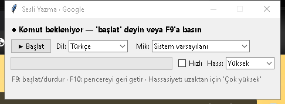

# 🎙️ Sesli Yazma

**Windows'ta her yerde çalışan, ücretsiz sistem geneli dikte uygulaması.**

Konuşun; yazdıklarınız **o anda odakta olan pencereye** gerçek klavye girişi olarak yazılsın. Word, tarayıcı, Notepad, Excel, WhatsApp Web, Discord… metin kutusu olan her yerde çalışır. Kopyala-yapıştır yok, ayrı bir metin kutusu yok.

[](../../releases/latest)
[](#)
[](#)
[](LICENSE)



---

## ✨ Özellikler

- **Sistem geneli dikte:** F9 ile başlat/durdur; yazı odaklı pencereye gider.
- **Metin kutusu yok:** Kopyala-yapıştır gerekmez, imlecin olduğu yere yazar.
- **Sesli başlatma:** Program kapalıyken bile "başlat" diyerek dinlemeyi açabilirsiniz.
- **Sesli komutlar:** "nokta", "virgül", "yeni satır", "gönder", "sil", "geri al" vb.
- **Türkçe karakter desteği:** ş, ğ, ı, ç, ö, ü komutlarda ve metinde sorunsuz.
- **Mesafeden konuşma:** Hassasiyet ayarı + otomatik kazanç (gain).
- **Mikrofon seçimi:** Cihazı değiştirdiğinizde **programı yeniden başlatmanız gerekmez**.
- **Mini kart:** Sağ üstte durur, odağı çalmaz; F10 ile geri getirilir.
- **Hızlı mod:** Sessizlik eşiğini 500 ms'den 300 ms'ye düşürür.
- **Tek dosya kurulum:** Python gerekmez; tüm bağımlılıklar paket içindedir.

---

## 📥 İndirme ve kurulum

1. [**Releases**](https://github.com/sinancan1/sesli-yazma/releases/latest) sayfasından `SesliYazma_Kurulum.exe` dosyasını indirin.
2. Dosyayı çift tıklayın → **İleri → Kur → Bitir**.
3. İsterseniz kurulum sırasında **"Masaüstü kısayolu oluştur"** seçeneğini işaretleyin.
4. Masaüstündeki **Sesli Yazma** kısayolundan programı açın.

> **Windows SmartScreen uyarısı:** Uygulama ücretsiz ve açık kaynak olduğu için dijital imza yoktur. "Windows bilgisayarınızı korudu" ekranı çıkarsa **Ek bilgi → Yine de çalıştır** deyin.

**Sistem gereksinimleri:** Windows 10/11 (64-bit), internet bağlantısı, mikrofon.

> **Kurulum, Microsoft Visual C++ 2015-2022 (x64) çalışma zamanını da kontrol eder; kurulu değilse kurulum tarafından otomatik kurulur.** Ayrı bir işlem yapmanız gerekmez.

### Kurulum olmadan (kaynak koddan)

Python 3.10+ kurulu olmalı:

```bash
git clone https://github.com/<kullanici>/sesli-yazma.git
cd sesli-yazma
python -m venv .venv
.venv\Scripts\python.exe -m pip install -r requirements.txt
.venv\Scripts\python.exe sesli_yazma.py
```

Windows'ta `setup.bat` dosyası bunu otomatik yapar; ardından `start.bat` ile çalıştırın.

---

## 🚀 Kullanım

1. Programı açın. Mini kart sağ üstte görünür.
2. Yazmak istediğiniz uygulamaya tıklayın (imleç metin alanında olsun).
3. **F9**'a basın veya **"başlat"** deyin. Kart "● Dinliyor…" durumuna geçer.
4. Konuşun. Her cümle/parça tanınıp odaklı pencereye yazılır.
5. Bitince **F9**'a tekrar basın veya **"durdur"** deyin.

| Kısayol | İşlev |
|---|---|
| **F9** | Dinlemeyi başlat / durdur |
| **F10** | Mini kartı geri getir |
| Kartı kapatma | Programdan çıkar |

> **İpucu:** Uzaktan konuşuyorsanız **Hassasiyet → Çok yüksek** seçin. Gürültülü ortamda "Yüksek" veya "Orta" daha iyi sonuç verebilir.

### Mikrofon değiştirme

Karttaki **Mik** kutusundan istediğiniz giriş cihazını seçin. Seçim **anında** uygulanır; programı yeniden başlatmanız gerekmez. Cihaz değişirken kart kısa süre "Mikrofon değiştiriliyor…" gösterir.

---

## 🗣️ Sesli komutlar

Aşağıdaki kelimeleri söylediğinizde metin olarak yazılmaz; ilgili işlem yapılır.

### Noktalama ve biçim

| Söylediğiniz | Sonuç |
|---|---|
| nokta | `.` |
| virgül | `,` |
| soru işareti / soru | `?` |
| ünlem işareti / ünlem | `!` |
| iki nokta | `:` |
| noktalı virgül | `;` |
| parantez aç / parantez kapa | `(` / `)` |
| tırnak aç / tırnak kapa | `"` |
| boşluk | boşluk |
| yeni satır | Enter |
| yeni paragraf | Çift Enter |

### Tuşlar ve düzenleme

| Söylediğiniz | Sonuç |
|---|---|
| gönder / enter | Enter |
| tab / sekme | Tab |
| sil | Backspace |
| kelime sil | Ctrl + Backspace |
| geri al | Ctrl + Z |
| tümünü sil / hepsini sil | Tümünü seç + sil |
| escape | Esc |

### Program kontrolü

| Söylediğiniz | Sonuç |
|---|---|
| başlat / dinlemeye başla | Dinlemeyi başlatır |
| durdur / programı durdur / kapat / bitir | Dinlemeyi durdurur |
| hızlı mod | Hızlı mod (300 ms sessizlik) |
| normal mod | Normal mod (500 ms sessizlik) |
| büyük harf | BÜYÜK HARF modu |
| küçük harf | Normal harf modu |

> "tamam", "evet", "hayır" gibi günlük kelimeler komut değildir; normal metin olarak yazılır.

---

## 🛠️ Sorun giderme

| Sorun | Çözüm |
|---|---|
| **"Mikrofon hatası"** | Windows Ayarlar → Gizlilik ve güvenlik → Mikrofon → "Uygulamaların mikrofonunuza erişmesine izin ver" açık olsun. |
| **"Google hizmetine ulaşılamadı"** | İnternet bağlantınızı kontrol edin; kurumsal ağlar/vpn engelliyor olabilir. |
| **Uzaktan algılamıyor** | Hassasiyeti **Çok yüksek** yapın; mikrofona doğrudan bakacak şekilde konumlandırın. |
| **Yanlış cihaz seçili** | Karttaki **Mik** kutusundan doğru cihazı seçin — yeniden başlatma gerekmez. |
| **Kart kayboldu** | **F10**'a basın veya görev çubuğundaki simgeye tıklayın. |
| **SmartScreen uyarısı** | **Ek bilgi → Yine de çalıştır**. |

---

## 🔒 Gizlilik ve notlar

- **Uygulama uzaktan hiçbir veri toplamaz.** Konuşma parçaları yalnızca tanıma için Google'ın ücretsiz Web Speech uç noktasına gönderilir; bunun dışında herhangi bir sunucuya, analiz servisine veya üçüncü tarafa veri aktarılmaz. Yazılar tamamen sizin bilgisayarınızda oluşturulur.
- Konuşma parçaları tanıma için **Google'ın ücretsiz Web Speech uç noktasına** gönderilir. Ayrı bir API anahtarı gerekmez.
- Uygulama kendi sunucusuna hiçbir veri göndermez; yazılar doğrudan bilgisayarınızda oluşturulur.
- Google uç noktası resmî olmayan, ücretsiz bir hizmettir; ileride değişebilir veya sınırlandırılabilir. Yoğun kullanım için Google Cloud Speech-to-Text gibi resmî bir API'ye geçmeniz önerilir.
- Bu proje Google, Microsoft veya başka bir şirketle bağlantılı değildir.

---

## 🧑‍💻 Geliştirme

### Derleme (tek dosya EXE)

```bash
.venv\Scripts\python.exe -m pip install pyinstaller
.venv\Scripts\pyinstaller.exe --noconsole --onefile --name SesliYazma ^
  --hidden-import sounddevice --hidden-import speech_recognition ^
  --hidden-import pynput --hidden-import pynput.keyboard ^
  --hidden-import numpy sesli_yazma.py
```

### Kurulum dosyası (Inno Setup)

1. [Inno Setup 6](https://jrsoftware.org/isinfo.php) kurun.
2. `installer.iss` dosyasını açıp derleyin veya komut satırından:

```bash
"C:\Program Files (x86)\Inno Setup 6\ISCC.exe" installer.iss
```

Çıktı: `installer_output\SesliYazma_Kurulum.exe`

---

## 🤝 Katkı

Hata bildirimi, öneri ve pull request'ler memnuniyetle karşılanır. Lütfen önce bir issue açın; büyük değişiklikler için yaklaşımı birlikte netleştirelim.

## 📄 Lisans

[MIT](LICENSE) — ücretsiz kullanabilir, değiştirebilir ve dağıtabilirsiniz.

---

<details>
<summary><b>English summary</b></summary>

**Sesli Yazma** is a free, open-source, system-wide dictation app for Windows. It uses Google's free Web Speech endpoint for Turkish (and 9 other languages) speech recognition, then types the result into whichever window has focus using real keyboard input — no copy-paste, no text box. Press **F9** to start/stop, say **"başlat"** to start by voice, and use voice commands for punctuation, Enter, Tab, undo, etc. The microphone can be switched instantly without restarting the app. Installer requires no Python; source build is Python 3.10+.

</details>
